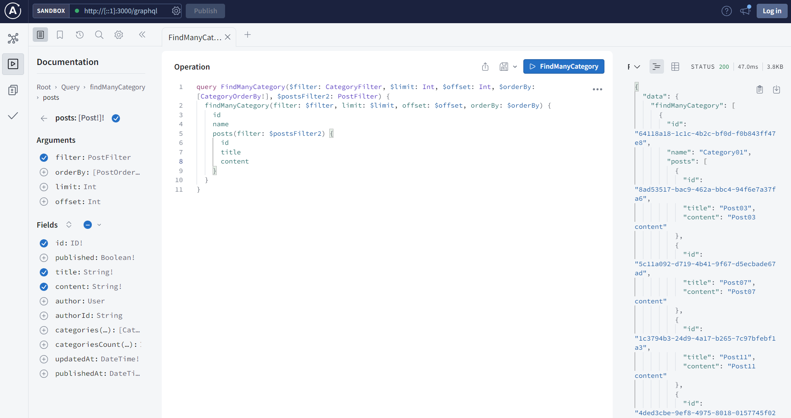

# pothos-prisma-generator

[](https://www.npmjs.com/package/pothos-prisma-generator)
[](https://www.npmjs.com/package/pothos-prisma-generator)
[](https://www.npmjs.com/package/pothos-prisma-generator)
[](https://deepwiki.com/node-libraries/pothos-prisma-generator)

Automatic generation of GraphQL schema from Prisma schema for [Pothos GraphQL](https://pothos-graphql.dev/).



## Overview

`pothos-prisma-generator` automatically generates full-featured GraphQL queries, mutations, relation fields, and filters directly from your `schema.prisma`.

The schema is built dynamically in-memory at runtime—no need to generate and manage boilerplate resolver/type files.

### Supported Operations & Features

- **Queries**: `count<Model>`, `findUnique<Model>`, `findFirst<Model>`, `findMany<Model>`
- **Mutations**: `createOne<Model>`, `createMany<Model>`, `updateOne<Model>`, `updateMany<Model>`, `deleteOne<Model>`, `deleteMany<Model>`, `upsertOne<Model>`
- **Relations**: Automatic 1-to-1, 1-to-many relation fields, plus relation count fields (e.g., `user.posts`, `user.postsCount`)
- **Paging & Sorting**: `limit`, `offset`, `cursor`, `distinct`, and multi-field `orderBy` (safely excluding list relations)
- **Filtering**: Deep filtering powered by Prisma (`equals`, `contains`, `mode` [Insensitive/Default], `AND`, `OR`, `NOT`, `in`, `lt`, `lte`, etc.)
- **Directives**: Configure permissions, filters, defaults, field visibility (`readable`), and mutability (`writable`) via schema comments (`/// @pothos-generator ...`)
- **Async Support**: Asynchronous `authority`, `replace`, and parameter callbacks supported out of the box
- **Built-in Scalars**: Auto-registers `BigInt`, `DateTime`, `Json`, `Decimal`, and `Bytes` via `graphql-scalars`

---

## Installation

```bash
npm install pothos-prisma-generator
# or
pnpm add pothos-prisma-generator
# or
yarn add pothos-prisma-generator
```

### Peer Dependencies

Ensure the following packages are installed in your project:

```bash
npm install @pothos/core @pothos/plugin-prisma @pothos/plugin-prisma-utils @prisma/client graphql
```

*(Optional: `@pothos/plugin-scope-auth` if using `authScopes`)*

---

## Setup

### 1. Configure `prisma/schema.prisma`

Add the `pothosPrismaGenerator` generator to generate the runtime DMMF:

```prisma
datasource db {
  provider = "postgresql"
  url      = env("DATABASE_URL")
}

generator client {
  provider = "prisma-client-js"
}

generator pothos {
  provider          = "prisma-pothos-types"
  generateDatamodel = true
}

generator pothosPrismaGenerator {
  provider = "pothos-prisma-generator"
  output   = "./generated/prisma-dmmf.ts"
}
```

Run `prisma generate`:

```bash
npx prisma generate
```

### 2. Configure Pothos SchemaBuilder

Add `PothosPrismaGeneratorPlugin` to your `SchemaBuilder`:

```typescript
import SchemaBuilder from "@pothos/core";
import PrismaPlugin from "@pothos/plugin-prisma";
import PrismaUtils from "@pothos/plugin-prisma-utils";
import ScopeAuthPlugin from "@pothos/plugin-scope-auth";
import PothosPrismaGeneratorPlugin from "pothos-prisma-generator";
import { PrismaClient } from "@prisma/client";
import { prismaDmmf } from "./generated/prisma-dmmf";

const prisma = new PrismaClient();

export interface Context {
  user?: { id: string; roles: string[] };
}

export const builder = new SchemaBuilder<{
  Context: Context;
  Prisma: typeof prisma;
}>({
  plugins: [
    PrismaPlugin,
    PrismaUtils,
    ScopeAuthPlugin,
    PothosPrismaGeneratorPlugin,
  ],
  prisma: {
    client: prisma,
    dmmf: prismaDmmf,
  },
  pothosPrismaGenerator: {
    authority: ({ context }) => context.user?.roles ?? [],
    replace: {
      "%%USER%%": ({ context }) => context.user?.id,
    },
  },
});

// Build GraphQL schema
export const schema = builder.toSchema();
```

---

## Directives Reference

Directives are written as triple-slash comments (`/// @pothos-generator <directive> <JSON5>`) above models or fields in `schema.prisma`.

### Model Directives

#### 1. `operation` - Filter generated operations

Controls which query and mutation fields are generated for the model.

- Supported operations:
  - `count`, `findUnique`, `findFirst`, `findMany`
  - `createOne`, `createMany`, `updateOne`, `updateMany`, `deleteOne`, `deleteMany`, `upsertOne`
- Shorthand groups: `query`, `mutation`, `find`, `create`, `update`, `delete`, `upsert`, `all`

```prisma
/// Exclude bulk mutations:
/// @pothos-generator operation {exclude:["deleteMany","updateMany"]}

/// Or only allow reading and creating single items:
/// @pothos-generator operation {include:["findMany","findFirst","findUnique","createOne"]}
```

#### 2. `executable` - Restrict operation execution permissions

Restricts who can execute specific operations on the model based on user authority.

```prisma
/// Only users with "ADMIN" role can delete records
/// @pothos-generator executable {include:["delete"],authority:["ADMIN"]}
```

#### 3. `where` - Default / Forced query filters

Automatically merges filters into queries. Often used for multitenancy or soft deletes.

```prisma
/// Only query non-deleted records
/// @pothos-generator where {where:{deletedAt:null}}

/// Automatically scope records to logged-in user
/// @pothos-generator where {where:{authorId:"%%USER%%"}}
```

#### 4. `order` - Default sort order

Specifies default sorting for `findMany` and `findFirst`.

```prisma
/// Default order by createdAt descending
/// @pothos-generator order {orderBy:{createdAt:"desc"}}
```

#### 5. `limit` - Enforce maximum fetch limit

Restricts maximum `limit` for `findMany`. Prevents requesting unbounded data.

```prisma
/// Cap at 100 records max
/// @pothos-generator limit {limit:100}
```

#### 6. `input-field` - Exclude fields from inputs

Omits specified fields from GraphQL input types (`CreateInput`, `UpdateInput`).

```prisma
/// Exclude auto-generated fields from create/update inputs
/// @pothos-generator input-field {fields:{exclude:["id","createdAt","updatedAt"]}}
```

#### 7. `input-data` - Auto-fill mutation data

Injects values into the data being saved. Values can use placeholders replaced by the `replace` builder option.

```prisma
/// Automatically set authorId from logged-in user
/// @pothos-generator input-data {data:{authorId:"%%USER%%"}}
```

#### 8. `option` - Pass Pothos field options

Passes custom options directly to Pothos field definitions (e.g., ScopeAuth options).

```prisma
/// @pothos-generator option {include:["mutation"],option:{authScopes:{authenticated:true}}}
```

#### 9. `readable` (Field directive) - Field visibility & access

Placed on individual model fields to restrict read access.

```prisma
model User {
  id    String @id @default(uuid())
  email String @unique

  /// Only ADMIN can read roles
  /// @pothos-generator readable ["ADMIN"]
  roles String[]

  /// Invisible in GraphQL schema (removed completely)
  /// @pothos-generator readable []
  secretToken String
}
```

#### 10. `writable` (Field directive) - Field mutation access

Placed on individual model fields to restrict or disable write access in mutations (`createOne`, `createMany`, `updateOne`, `upsertOne`).

- Setting `writable false` completely omits the field from all GraphQL input types.
- Setting `writable ["ADMIN"]` (or `{ authority: ["ADMIN"] }`) validates user authority at mutation runtime and rejects unauthorized writes.

```prisma
model User {
  id    String @id @default(uuid())
  email String @unique

  /// Never allow writing via mutations (excluded from input types)
  /// @pothos-generator writable false
  createdAt DateTime @default(now())

  /// Only ADMIN can update or create with this field
  /// @pothos-generator writable ["ADMIN"]
  roles String[]
}
```

---

## Code API: Dynamic Model Extensions

You can also customize directives and add custom fields programmatically in TypeScript:

### Adding Custom Fields to a Model

```typescript
builder.addModelFields("User", {
  fullName: (t) =>
    t.string({
      resolve: (parent) => `${parent.firstName} ${parent.lastName}`,
    }),
});
```

### Adding Directives via Code

```typescript
// Restrict operations
builder.addModelOperations("User", {
  include: ["createOne", "updateOne", "findMany"],
});

// Add field directives
builder.addFieldDirectives("User", "roles", "readable", ["ADMIN"]);
builder.addFieldDirectives("User", "createdAt", "writable", false);
```

### Parameter Callbacks

Inspect or mutate query arguments before execution:

```typescript
builder.addModelParameterCallback(async (params, { modelName, operationPrefix }) => {
  console.log(`Executing ${operationPrefix} on ${modelName}`);
  return params;
});
```

---

## License

MIT
